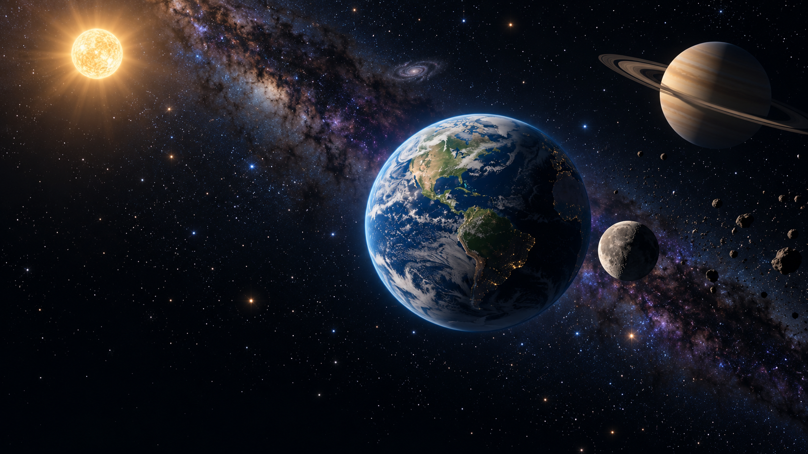

# Earth 视觉提升提案：从几个球体到有层次的宇宙

当前实施状态见[视觉QA](earth-visual-qa-results.md)：本轮已完成程序视觉代码，原表为提案时点；实际画面、GPU编译及性能待用户验收。

| 项目            | 说明                                                                                                                                                          |
| --------------- | ------------------------------------------------------------------------------------------------------------------------------------------------------------- |
| 日期 / 核对代码 | 2026-10-17 / `fef2dcb`，V2 Sun 已实现；V3/V4 仍是计划                                                                                                         |
| 状态            | 视觉提案，未实施；用户已选择 cinematic natural space 美术方向                                                                                                 |
| 用户反馈        | 当前看起来只有几个球体，背景和细节太简单，希望增加星空、银河、宇宙对象及天体表现                                                                              |
| 推荐路线        | 先做分层背景与现有天体材质，再补少量空间景物；第一轮沿用离线程序生成                                                                                          |
| 讨论模式        | /office-hours Builder；基于当前源码和用户反馈，不是浏览器视觉审计                                                                                             |
| 相关资料        | [开发交接](prd-earth-handoff.md)、[V2](earth-v2-plan.md)、[V3](earth-v3-plan.md)、[V4](earth-v4-plan.md)、[ADR 0003](decisions/0003-earth-sun-composition.md) |

## 1. 想达到的画面

**Earth 是清楚可辨认的主角；远处有细密星空、一道柔和银河和局部星云，中景有可辨认的天体，少量近景细节让移动产生空间感。**

风格为自然、安静、略带电影感的宇宙。深蓝黑底色、白/微暖/微蓝的星点、克制的紫蓝星际尘埃、暖色 Sun、薄薄的蓝色大气。不是把所有区域填满彩色星云，也不靠增加一排相似球体解决内容感。

### 方向概念图

这是 AI 生成的**美术方向图**，不是当前游戏截图或可直接运行的背景。银河细节、真实地理形态、城市灯光和画面中的较密小行星属于理想参考；第一轮不承诺全部实现。落地时小行星更少、Sun 光芒更克制，留白和 UI 可读性优先。

图片没有接入游戏，也不能把整个画面贴成一张图替代可移动的场景。[生成工具及完整提示词](assets/earth-visual-concept-v1.prompt.md) 随文档保存。

## 2. 当前已有，为什么仍显得简单

| 当前源码事实                                         | 提升机会                                                          |
| ---------------------------------------------------- | ----------------------------------------------------------------- |
| 已有 4,200 个星点，尺寸统一为 `1.15`，在远处球壳分布 | 星点已有，不需再盲目叠一套；改善大小/亮度层次、圆形光核与疏密分布 |
| 已有 900 个淡紫色尘埃点，位于场景一侧                | 点云还不是可辨认的银河带、星际暗带或星云结构                      |
| Earth 是程序海陆色块，云状斑点画在同一张贴图里       | 陆地轮廓、海洋反光、云层高度和日夜关系缺少区分                    |
| Sun 是 BasicMaterial 球体加一层 halo                 | 可加入表面颗粒、细微流动与更自然的日冕过渡                        |
| Moon 是灰色、平面着色的二十面体细分模型              | 缺陨石坑、粗糙度与表面高低的受光细节                              |
| 有环星球表面接近纯色，星环已有径向颜色变化           | 缺气体条纹、细分环带和更可信的球/环遮挡                           |
| 场景几乎没有独立近中景装饰                           | 玩家移动时缺少足够的视差线索与远近参照                            |
| 共享 UI 的暗色覆盖渐变会压暗部分画面                 | Earth 可单独检查覆盖色与强度，不全局重做其他世界 UI               |

这些是源码判断。用户看不到明显星点可能与尺寸、分布、亮度、屏幕和覆盖层有关，本次没有控制浏览器，不能直接断言是渲染错误。应以用户真实画面做前后比对。

## 3. 三种实现路线

| 路线                        | 内容                                                   | 相对成本/风险 | 适用与代价                                                 |
| --------------------------- | ------------------------------------------------------ | ------------- | ---------------------------------------------------------- |
| A：渐进式程序美术，推荐首轮 | 复用星点和天体，Canvas 纹理、少量局部 Shader、分层背景 | 中 / 低到中   | 符合现有静态离线架构，无需先改资源服务；表面精度有上限     |
| B：有授权的本地贴图包       | 精选行星/星空/陨石坑贴图，离线随包分发                 | 中 / 中       | 逼真程度更直接；需核实授权、资源体积、服务 MIME 与构建路径 |
| C：完整高精度渲染管线       | 高精度 PBR、多层大气、体积星云、后处理 bloom 等        | 高 / 高       | 长期表现上限高；超出当前首轮需求，显存、GPU 和接入成本更大 |

建议从 A 做出可比较的完整画面。若程序海陆始终达不到希望的精度，再为少量主角资源选 B；不先引入 C 的整套框架。这是提案推荐，不代表素材来源、依赖或实施范围已经批准。

自然观感不等于程序生成大陆必须复刻真实地球地理。若需要准确真实地理，应明确改走有来源、有授权的贴图路线。

## 4. 背景分四层，不只是增加星点数量

| 层级   | 建议增加/调整                            | 玩家看到的变化                       | 实现边界                                    |
| ------ | ---------------------------------------- | ------------------------------------ | ------------------------------------------- |
| 极远层 | 深蓝黑底、细密星场、银河与暗带           | 一进入就有宇宙尺度和方向感           | 远景不随玩家平移产生明显近景视差            |
| 远层   | 一处低对比星云、少量遥远星系轮廓         | 有值得观察的环境地标，仍保持暗部留白 | 装饰，不给 E 提示，不伪装成可抵达的玩法目标 |
| 中层   | 现有 Sun、Moon、有环星球的细节和清楚轮廓 | 每个对象有独特身份，而非几个同类球体 | 四个主要天体继续复用，不增加同用途行星      |
| 近中层 | 1–2 小簇稀疏小行星，极少量空间微粒       | 移动时能感知远近和经过的空间         | 先避开可达操作区域，无碰撞/采集/新事件系统  |

### 4.1 星场

- 第一轮可保留原 4,200 的数量，先改表现，避免把数量当质量指标。
- 多数小而暗，少数稍亮稍大，极少数显著亮星；不让所有点一样亮、一样大。
- 使用圆形软光核，避免明显方点；可以由本地 Canvas 生成星点遮罩或局部 point shader 实现。
- 颜色以中性白为主，少量偏暖/偏蓝，不把每颗星染成高饱和色。
- 空间分布有疏密：银河附近更密、其他区域保留黑暗。首轮不闪烁；后续仅少数亮星可极缓慢变化，减弱动态时冻结。

### 4.2 银河、星云与遥远星系

- 银河是一道跨越视野的低对比宽带，包含恒星密度变化与暗尘纹理，不是一条高亮彩虹。
- 星云只选一个局部区域，采用很淡的蓝紫/灰青调，不把整个背景刷成紫色烟雾。
- 遥远星系最多先做 1–2 个小而模糊的轮廓，作为空间地标；不要在每个方向都摆一张巨大螺旋星系。
- 优先构建一次生成的低分辨率背景密度纹理，叠加独立星点。先不做逐像素体积 raymarch。
- 检查环绕观察 360°、贴图接缝、极点和透明排序；背景不能只是默认视角好看、转身后完全空白。

现有 `main.js` 会让 `world.sky.position` 跟随 camera，Earth 当前没有使用该字段。可复用这一已有入口，把极远星空放在一个 Earth 专用 sky Group 内，无需为背景新增摄像机接口；近中景小行星留在 scene 世界坐标里以提供视差。

星空和银河是外观层，不参与共享相遇概率、对白候选或世界移动边界。不要把纯装饰星系误注册为可互动实体。

远景几何必须位于当前有效 `camera.far=3500` 内，采用从球内可见的面向/材质，不写深度去遮盖玩法对象。跟随 camera 的是平移，不复制其旋转，以保持星空的世界方向。迁移时明确替换或重挂原星点与尘埃，不能留下一套旧的世界坐标背景与新天空重复漂移。

### 4.3 少量宇宙景物

首轮可选 1–2 簇、总计约 24–48 个小岩体，用低面数变体和 InstancedMesh 等方式合批；数量是试做上限，不是必须全部放满。先置于玩家移动圆盘之外，并检查 Moon 轨道、Sun/行星轮廓不被遮挡。

不添加包围 Earth 的拥挤碎石环。彗星、流星、遥远双星等放到后续装饰候选；若加入运动，需有暂停/减弱动态策略，不能变成独立定时事件调度器。

## 5. 四个已有天体怎么变好看

### Earth：最优先的主角

**希望看到：**明显的海洋、自然海岸、大陆层次、漂浮云层、薄大气和清晰但不过黑的暗面。

- 将海陆从大块色斑改善为多尺度形状：大轮廓、海岸过渡、适量地表颜色变化。
- 区分海面与陆地粗糙度，让海洋有克制的方向性高光，而不是整球同样粗糙。
- 增加轻微的法线/凹凸表现；先影响受光，不扩大模型包络或改碰撞/操作范围。
- 把云从画在地面贴图的斑点拆成一层低成本半透明外壳，缓慢独立移动；保持它位于现有大气内，防止穿插与过度发白。
- 保留薄蓝色大气边缘，避免宽大荧光圈。通过现有 Sun 的方向让日夜边界更可信。
- 暗面城市灯光、云对地面投影和更复杂大气散射放到后续，不作为首轮必做项。

不能同时留下原贴图的明显云斑和新云层，制造重复漂浮感。云外壳更新通过原 Earth 组合 update 接入，不增加 RAF。

云层的父节点与旋转来源应明确：例如挂在 `w.avatar` 下独立更新；若挂在自转的 `w.globe` 下，只增加相对旋转，不再重复施加完整的 Earth 自转。

### Sun：有纹理的发光天体

**希望看到：**暖白核心、可辨认颗粒、柔和且局部的外晕，不再像纯色灯泡。

- 在已有 Sun 球体上加入程序表面颗粒与少量低频明暗流动，不用不断扭曲整球的动画。
- 用更平滑的径向过渡改善原 halo，必要时少量不规则边缘表现日冕。
- 保持实际 DirectionalLight 的位置/target 与可见 Sun 一致；模型发亮和照亮 Earth 是不同职责。
- 先用局部材质/Shader 做视觉辉光，不默认引入整屏 bloom 或 lens flare。
- 保留 V2 的 3 秒响应/5 秒冷却、halo 受控缩放及禁用恢复；基础视觉样式要在其记录 baseline 前完成。

概念图的太阳光线比首轮目标更强；落地以 Earth 和文字不被过曝为准。

### Moon：灰色岩石，而非灰色球

**希望看到：**不同大小的陨石坑、低反射灰尘、坑缘受光和清楚的球体阴影。

- 可在初始化时使用更平滑的球面几何，配程序陨石坑颜色/凹凸纹理，消除过强的低多边形玩具感。
- 坑口、坑壁和大面积暗区有层次，不随机铺一张均匀噪声。
- 保持粗糙低反射，不使用金属质感；照明仍来自现有 Sun。
- 保留半径、原 Mesh 的角色与场景内身份、talker、邀请状态与轨道。不得另造“高精度装饰月亮”与原互动 Moon 重叠。
- 为 V4 保留附加 emissive/颜色的明确归属，基础材质设置先于关系效果记录 baseline。

### 有环星球：气体条纹与薄环

**希望看到：**柔和的大气带、少量涡旋差异、分层薄环，以及球体遮住星环时的空间关系。

- 原 `gas` 球体增加低饱和带状纹理与微弱扰动，避免纯色表面或过于规则的条纹。
- 原 `ring` 增加细密径向带、透明度差异和少量间隙，不堆几千块单独环石。
- 先保证球/环的深度遮挡、双面显示和不同角度的透明排序。真实环影/行星投影后置，不能把深度遮挡写成已实现投射阴影。
- 保留原 Group、球体与环的身份及位置/倾角；未来 V3 的局部反馈只在自己拥有的字段上叠加/恢复。
- 继续叫“有环星球”，是否正式命名 Saturn 是内容决定，不是视觉升级必须新增一颗星球的理由。

## 6. 构图与 UI

默认画面应有三个读图层级：**Earth 主体 → 可接近的天体 → 星空/银河环境**。Sun 可以是最亮点，但不应让 Earth 失去视觉中心。

- 左侧现有章节/尺度文案及底部导航周围留出较暗区域，不把最亮银河结点放在文字后面。
- 默认、最近/最远缩放、不同窗口比例都能看清 Earth 轮廓；不要求所有天体永远完整入镜。
- 首轮不自动调整 FOV、接管镜头、增加镜头摇晃或大幅改变现有对象位置。需要改布局时，同步确认操作距离和可达性。
- 可单独评估 `body[data-world='3']` 下的覆盖层色调，避免通用绿色渐变把太空细节压没；这属于需要协调的局部 CSS 修改，不是全站 UI 重做。
- 不新增满屏标记、轨道线、雷达、目标箭头或一套 HUD 来弥补美术可读性。

## 7. 推荐交付顺序

| 阶段                   | 具体交付                                                     | 验收重点                                                |
| ---------------------- | ------------------------------------------------------------ | ------------------------------------------------------- |
| P0-A：先让空间成立     | 星场层次、银河带/暗尘、全向背景、默认构图                    | 不操作也有丰富宇宙感，转动后不露空白，Earth/UI 保持清楚 |
| P0-B：四个主角各有材质 | Earth 海陆/云、大气；Moon 陨石坑；Sun 表面/halo；气体带/星环 | 从正常游戏距离能区分材料和天体身份，不再只靠球体颜色    |
| P1：补空间参照         | 少量小行星簇、1–2 个淡远星系、一个局部星云                   | 移动有视差和地标，主画面不过载，无新增玩法混淆          |
| P2：有依据再加         | 夜侧灯光、更细环影、低成本彗星或精选本地贴图                 | 已有性能/画质比较后再选一个增量，不全做                 |

第一轮的“明显更丰富”应在 P0 就能看见，不需要等 V3 引力或 V4 组合实现。视觉工作可以与玩法并行，但不得覆盖未提交功能或改变它们的范围。

## 8. 代码、资源和性能边界

### 文件与模块

- `space.js`：继续装配现有对象，改初始化几何/材质与背景挂载。
- 可新增 Earth 专用 `earth-background.js`、`earth-materials.js` 等实际需要的文件，分离背景生成与贴图生成，不创建全项目渲染框架。
- `earth-actions.js`：`installEarthActions` 仍是 `world.update` 的唯一安装者。只有新增云层/表面动画确实需要时，由它组合一个可选 visual update；Moon/Sun 原 handler 每帧仍各执行一次，视觉初始化器不能再次赋值覆盖 world.update。
- `earth-sun.js`：默认保留玩法；若 halo 或材质角色变化影响其 baseline，局部协调并补测试，不能换一套无法被禁用恢复的效果。
- `earth-moon.js`、共享动作/移动/镜头、其他世界、vendor、prototypes、依赖和 CI 默认不改。
- Earth 专属 CSS、外部资源格式和共享 API 如确有需要，单独说明范围，不作为顺手重构。

### 离线资源

第一轮使用 CanvasTexture/本地 Shader，不需要网络素材。当前静态服务不接受 PNG/JPEG/GLB 等运行时资源，build 也不复制任意顶层 assets；选路线 B 时必须配套服务/MIME/构建访问测试及许可记录。

本文概念图放在 `docs/assets/`，仅供文档评审，不在游戏发布目录中，未更改资源服务规则。不要把它作为未经拆分的游戏天空或整张场景使用。

### 建议预算，而非已测结论

- 首轮先复用星点数量，采用少量合批/背景材质，建议标准画质新增 draw calls 先控制在约 12 以内；实际值由 renderer 记录核对。
- 主角色彩贴图上限先取 `2048×1024`，其他贴图按用途用 512/1024 级别；无必要不升 4K。
- 新增纹理显存建议先控制在约 48 MiB 内。RGBA8 加完整 mip 的估算约为宽×高×4×4/3，实际格式、mip 和 GPU 分配需另测，不把文件体积当显存。
- 背景/材质生成一次并缓存，不在每帧或每次 E 重画贴图；新随机内容使用局部种子，不扩大共享随机流影响。
- 云层、Sun 表面等动画尊重 canSimulate/reducedMotion；减弱动态时冻结非必要循环视觉，主动作静态反馈仍可辨认。
- 量测前不保证某台 Mac 的帧率。先争取演示设备稳定 30 FPS；不改全局 DPR 或自动质量系统来掩盖成本。

画质档可先作为开发配置：低档关闭远星系/星云/小行星及复杂云动画，标准档启用 P0/P1。用户设置界面和自动分档不是本轮必需项。

实现前列出本轮贴图清单：对象、用途、宽高、格式、mip、估计字节数与共享关系；不因为每张都低于 2K 就假定总预算合格。记录首次进入 Earth 的纹理生成耗时和可感知卡顿，并与再次返回比较。若初始化明显停顿，先减少非关键贴图分辨率/数量或分段生成，不默认增加 Worker 框架。用户只需观察首次进入是否卡住，无需先做专项性能分析。

## 9. 与 V1–V4 的字段所有权

| 内容                                   | 基础视觉拥有者     | 玩法叠加拥有者                           |
| -------------------------------------- | ------------------ | ---------------------------------------- |
| Earth 海陆/云纹理、Moon 坑纹、气体条纹 | 本次视觉初始化     | 不改变互动状态                           |
| Earth 大气基础色                       | 视觉初始化先设置   | V2 Sun 响应捕获基线后按原规则叠加/恢复   |
| Sun halo 的基础材质/尺度               | 视觉初始化先设置   | V2 只对约定字段做一次响应，禁用恢复正确  |
| Moon 基础 color/emissive               | 视觉初始化先设置   | V4 若实现，增加一次有界贡献并恢复        |
| 有环星球基础纹理/环透明度              | 视觉初始化先设置   | V3 若实现，只叠加其明确拥有的局部反馈    |
| 云/背景动画时间                        | 局部 visual update | 不接管 Moon 轨道、Sun 响应计时或相遇策略 |

不可在玩法已经保存旧 baseline 后，每帧偷偷覆盖基础色。场景返回时复用同一资源与状态，不重装对象。测试对比同一次 scene 的身份，而不是要求不同代码版本重新加载后仍是同一个内存对象。

## 10. 验收与前后对照

下列为完整路线的检查清单，按本轮实际阶段验收：P0-A 检查背景/构图与前序回归；首个 Earth/Moon 材质增量只验收这两个天体；Sun/有环星球细节在对应 P0-B 增量验收，近景视差在 P1 验收。延期项明确列出，不误记成已完成，也不以尚未承诺的内容阻挡首轮交付。

### 用户实际画面

1. 默认进入 Earth，不移动也能看到细密星空与银河层次，主角轮廓仍清楚。
2. 环绕 360°、缩放两端：无明显星空接缝、背景方片、云/大气穿插、环透明排序错误。
3. 正常距离可辨认 Earth 云海陆、Moon 坑纹、Sun 颗粒与薄晕、有环星球的气体带和细环。
4. 移动时远景保持遥远，近中景提供适量视差，没有景物粘在镜头上或整幅星空近距离漂移。
5. 对比普通与减弱动态，画面都完整，非必要闪动/循环能停止。
6. Moon 邀请/轨道、Sun E 回应/结束/禁用恢复、四层控制和草招募不回退；已落地的 V3/V4 同样回归，不凭计划创建假功能。
7. 在用户自己的演示机器检查日常流畅度；量化专项按同设备/浏览器/视口/DPR 比较，不混用强制 GC 诊断会话。

取证建议用同一位置和镜头保存“默认全景、Earth 近景、Moon、Sun、有环星球、背向星空”六组前后图。图片能比较明确变化，不能只凭形容词宣称完成。先让另一位试玩者观察 10 秒，说明他注意到的主体、空间深度和最想靠近的对象，再决定是否继续增加装饰。

### Codex 非浏览器检查

- `npm run check`，保留既有逻辑、原件和服务访问测试。
- 真实工厂检查主要天体/talker 身份、纹理/材质资源复用、重复更新不生成新资源引用。
- 新背景不注册 talker；装饰数量与主体数量分开，不删除旧断言来容纳重复行星。
- 视觉新增资源会合理改变几何/材质库存，应把预期变更写清，不降低成“只要存在对象就通过”。

沿用已明确的执行分工：Codex 不控制浏览器、不运行/新增 E2E，用户完成键鼠/画面/声音观察。Node 身份检查不证明 GPU 无泄漏、画质合格或帧率已达标。

## 11. 待实施前选择与下一步

用户已选择电影感自然宇宙风格。尚待按实际条件选择：首轮是否只做 P0，真实地理贴图是否必要，演示机器/可接受性能，以及小行星是否进入 P1。上述为实施选择，不阻止本提案交付，也不表示已批准全部内容。

**推荐下一个可审阅增量：P0-A 星空/银河 + Earth/Moon 基础材质。** 先在同一默认镜头对比视觉与成本，再完成 Sun/有环星球细节。不要等待全部玩法版本结束后才改善画面。

本次只是方案与概念图，不修改游戏、不接入运行时素材、不提交/推送/合并/部署。
